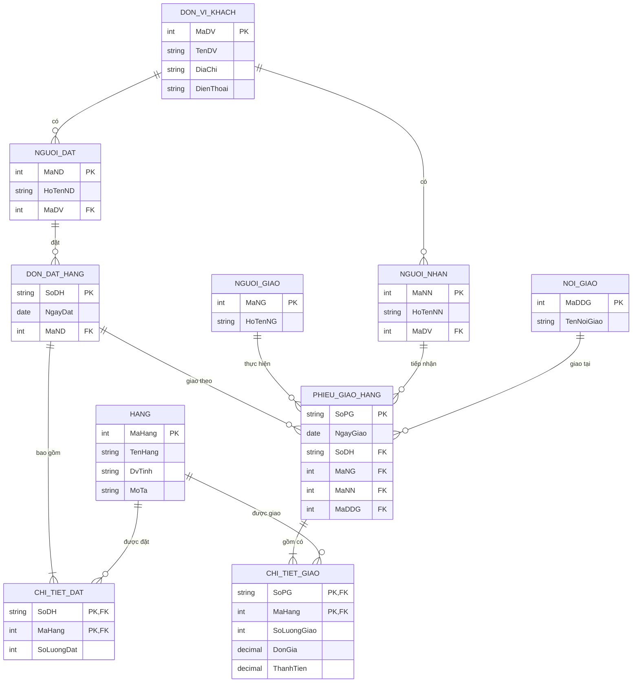
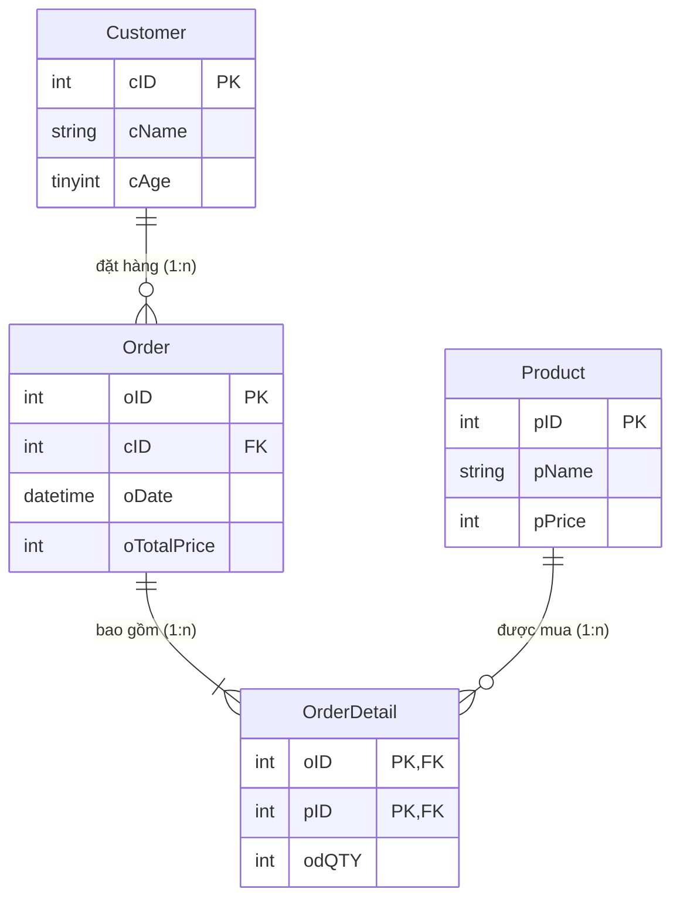

# [Thực hành] Thêm dữ liệu vào trong cơ sở dữ liệu Quản lý Sinh viên

Mã nguồn thực hành bài học Module 3 - Cơ sở dữ liệu quan hệ (RDBMS & SQL) tại [CodeGym](https://codegym.vn).

---

## 🎯 Mục tiêu
- Sử dụng thành thạo câu lệnh `INSERT INTO` để thêm dữ liệu vào các bảng trong MySQL.
- Hiểu được sự khác biệt giữa:
  - Thêm dữ liệu cho tất cả các cột theo thứ tự mặc định (`INSERT INTO Table VALUES (...)`).
  - Thêm dữ liệu chỉ định các cột cụ thể (`INSERT INTO Table (col1, col2, ...) VALUES (...)`) – đặc biệt hữu ích khi bảng có cột `AUTO_INCREMENT` hoặc cho phép giá trị `NULL`.
  - Thêm nhiều dòng dữ liệu cùng một lúc trong một câu lệnh duy nhất.
  - Sử dụng hàm ngày tháng hệ thống như `CURRENT_DATE`.

---

## 📁 Cấu trúc thư mục

- [`QuanLySinhVien.sql`](file:///d:/a/QuanLySinhVien.sql): File tạo cơ sở dữ liệu `QuanLySinhVien` và tạo 4 bảng (`Class`, `Student`, `Subject`, `Mark`) từ bài thực hành trước.
- [`insert-into.sql`](file:///d:/a/insert-into.sql): Các câu lệnh `USE QuanLySinhVien;` và `INSERT INTO` vào 4 bảng theo đúng yêu cầu bài tập.
- [`QuanLySinhVien_Full.sql`](file:///d:/a/QuanLySinhVien_Full.sql): File kịch bản hoàn chỉnh (Tạo CSDL -> Tạo bảng -> Chèn dữ liệu -> `SELECT *` kiểm tra dữ liệu).
- [`create_database.sql`](file:///d:/a/create_database.sql): Script tạo cơ sở dữ liệu `my_database1` trên MySQL Workbench bằng câu lệnh SQL.
- [`drop_database.sql`](file:///d:/a/drop_database.sql): Script xóa cơ sở dữ liệu trên MySQL Workbench bằng câu lệnh SQL.
- [`create_table.sql`](file:///d:/a/create_table.sql): Script tạo bảng `Class` và `Teacher` trong CSDL `student-management`.
- [`quan_ly_don_hang.sql`](file:///d:/a/quan_ly_don_hang.sql): Triển khai mô hình cơ sở dữ liệu quan hệ hoàn chỉnh từ sơ đồ ERD Quản lý đơn đặt hàng và giao hàng.
- [`erd_quan_ly_don_hang.jpg`](file:///d:/a/erd_quan_ly_don_hang.jpg): Ảnh sơ đồ mô hình thực thể ERD chuẩn hóa.
- [`create-table.sql`](file:///d:/a/create-table.sql): Script tạo 4 bảng cho CSDL `QuanLyDiemThi` chuẩn theo bài thực hành.
- [`QuanLyDiemThi.sql`](file:///d:/a/QuanLyDiemThi.sql): File kịch bản đầy đủ CSDL `QuanLyDiemThi` gồm tạo bảng, dữ liệu mẫu và truy vấn JOIN kiểm tra.
- [`healthsync_db.sql`](file:///d:/a/healthsync_db.sql): File kịch bản DDL/DML tái cấu trúc hệ thống phòng khám HealthSync theo UML Activity Diagram.
- [`consistency_report.md`](file:///d:/a/consistency_report.md): Báo cáo phân tích đối chiếu (Gap Analysis) chỉ ra 3 điểm vênh nghiêm trọng giữa UML và ERD cũ.
- [`ai_prompt_log.md`](file:///d:/a/ai_prompt_log.md): Nhật ký đối thoại và khai thác AI phục vụ thiết kế dữ liệu và tối ưu hóa hệ thống.
- [`erd_to_relational_schema.jpg`](file:///d:/a/erd_to_relational_schema.jpg): Ảnh trực quan chuyển đổi mô hình ERD sang mô hình dữ liệu quan hệ.
- [`chuyen_doi_erd_sang_quan_he.md`](file:///d:/a/chuyen_doi_erd_sang_quan_he.md): Báo cáo 4 bước chuyển đổi chi tiết các bảng và thuộc tính đa trị.
- [`erd_chuyen_doi_quan_he.sql`](file:///d:/a/erd_chuyen_doi_quan_he.sql): Kịch bản MySQL tạo 8 bảng quan hệ chuẩn hóa và dữ liệu mẫu kiểm thử.
- [`QuanLyBanHang.sql`](file:///d:/a/QuanLyBanHang.sql): Script tạo CSDL `QuanLyBanHang`, 4 bảng có ràng buộc khóa ngoại và dữ liệu mẫu kiểm thử.
- [`thao_tac_csdl_quan_ly_ban_hang.sql`](file:///d:/a/thao_tac_csdl_quan_ly_ban_hang.sql): File kịch bản [Bài tập] Thao tác với CSDL `QuanLyBanHang` (thêm dữ liệu, INNER JOIN, Anti-Join, GROUP BY tính tổng tiền hóa đơn).
- [`autoride_db.sql`](file:///d:/a/autoride_db.sql): File kịch bản DDL/DML tái cấu trúc hệ thống thuê xe AutoRide theo UML Activity Diagram.
- [`er_activity_mapping.md`](file:///d:/a/er_activity_mapping.md): Báo cáo đối chiếu nghiệp vụ, phân tích 3 Data Gaps và giải trình cột `damage_fee`.
- [`select-query.sql`](file:///d:/a/select-query.sql): File kịch bản các câu lệnh SELECT và JOIN truy vấn CSDL `QuanLySinhVien`.
- [`query_quanlysinhvien.sql`](file:///d:/a/query_quanlysinhvien.sql): File kịch bản [Bài tập] Truy vấn dữ liệu nâng cao (LIKE, MONTH, BETWEEN, UPDATE, ORDER BY) trên CSDL `QuanLySinhVien`.
- [`group-by.sql`](file:///d:/a/group-by.sql): File kịch bản [Thực hành] Sử dụng các hàm thông dụng trong SQL (COUNT, AVG, GROUP BY, HAVING, ALL) trên CSDL `QuanLySinhVien`.
- [`flashmart_reports.sql`](file:///d:/a/flashmart_reports.sql): Kịch bản MySQL tối ưu hóa truy vấn LEFT JOIN cho Marketing và Anti-Join cho Kho vận Sàn TMĐT FlashMart.
- [`join_analysis.md`](file:///d:/a/join_analysis.md): Báo cáo phân tích tập hợp (Set Theory), giải trình COUNT(o.order_id) vs COUNT(*) và 3 câu hỏi vấn đáp.
- [`payflow_optimized.sql`](file:///d:/a/payflow_optimized.sql): Kịch bản MySQL tối ưu hóa truy vấn Non-SARGable và B-Tree Index cho Ví điện tử PayFlow.
- [`explain_analysis.md`](file:///d:/a/explain_analysis.md): Báo cáo đối chiếu chỉ số EXPLAIN (ALL vs range), Covering Index và 3 câu hỏi vấn đáp CTO.

---

## 🛠️ [Thực hành] Tạo CSDL trên MySQL Workbench

### Cách 1: Sử dụng giao diện đồ họa (GUI)
1. Mở MySQL Workbench và kết nối tới MySQL Server (nhập mật khẩu tài khoản `root`).
2. Nhìn sang bảng bên trái tại tab **SCHEMAS**, click vào biểu tượng **Create a new schema in the connected server** (biểu tượng hình cái đĩa trụ có dấu `+` nhỏ).
3. Nhập tên CSDL mới: `my_database1`.
4. (Tùy chọn) Chọn **Charset: utf8mb4** và **Collation: utf8mb4_general_ci** để hỗ trợ tiếng Việt đầy đủ.
5. Nhấn **Apply**, xem lại câu lệnh SQL tự sinh rồi nhấn tiếp **Apply** $\rightarrow$ **Finish**.

### Cách 2: Sử dụng câu lệnh SQL
1. Nhấn vào biểu tượng **Create a new SQL tab for executing queries** (hoặc nhấn phím tắt `Ctrl + T`).
2. Nhập câu lệnh:
   ```sql
   CREATE DATABASE `my_database1`;
   ```
3. Nhấn biểu tượng hình tia sét ⚡ (hoặc tổ hợp phím `Ctrl + Enter` / `Ctrl + Shift + Enter`) để thực thi câu lệnh.
4. Chuột phải vào vùng trống trong tab **SCHEMAS** chọn **Refresh All** để thấy `my_database1` xuất hiện.

---

## 🗑️ [Thực hành] Xóa CSDL trên MySQL Workbench

> [!WARNING]
> Thao tác xoá CSDL sẽ xóa toàn bộ các bảng, quan hệ và dữ liệu bên trong CSDL đó vĩnh viễn. Hãy kiểm tra kỹ trước khi xóa!

### Cách 1: Sử dụng giao diện đồ họa (GUI)
1. Bật MySQL Workbench và đăng nhập bằng tài khoản và mật khẩu.
2. Tại tab **SCHEMAS** bên trái, tìm CSDL muốn xóa (ví dụ `my_database1`).
3. Nhấp chuột phải vào tên CSDL và chọn **Drop Schema...**
4. Một hộp thoại cảnh báo sẽ xuất hiện:
   - Chọn **Review SQL**: Nếu muốn xem trước câu lệnh xóa.
   - Chọn **Drop Now**: Để xóa ngay lập tức CSDL.
5. Kiểm tra bảng **Output** phía dưới, nếu có dấu tích xanh là CSDL đã được xóa hoàn tất.

### Cách 2: Sử dụng câu lệnh SQL trên Workbench
1. Nhấn chọn biểu tượng **New Query Tab** (`Ctrl + T`) để mở cửa sổ soạn thảo mới.
2. Nhập câu lệnh SQL sau:
   ```sql
   DROP DATABASE `my_database1`;
   -- Hoặc an toàn hơn (không báo lỗi nếu CSDL không tồn tại):
   -- DROP DATABASE IF EXISTS `my_database1`;
   ```
3. Nhấn vào biểu tượng **Tia sét ⚡** (hoặc `Ctrl + Enter`) để chạy câu lệnh.
4. Kiểm tra cửa sổ **Output** bên dưới: dấu tích màu xanh báo hiệu thành công.
5. Nhấp chuột phải vào tab **SCHEMAS** $\rightarrow$ chọn **Refresh All** để xác nhận CSDL đã biến mất.

---

## 📊 [Thực hành] Tạo bảng trên MySQL Workbench

### 1. Bảng `Class`
| Tên cột | Kiểu dữ liệu | Ràng buộc |
|:---|:---|:---|
| `id` | `INT` | Primary Key (PK), Not Null (NN), Auto Increment (AI) |
| `name` | `VARCHAR(50)` | Cho phép Null |

### 2. Bảng `Teacher`
| Tên cột | Kiểu dữ liệu | Ràng buộc |
|:---|:---|:---|
| `id` | `INT` | Primary Key (PK), Not Null (NN), Auto Increment (AI) |
| `name` | `VARCHAR(50)` | Cho phép Null |
| `age` | `INT` | Cho phép Null |
| `country` | `VARCHAR(50)` | Cho phép Null |

### Cách 1: Sử dụng giao diện đồ họa (GUI)
1. **Khởi động Workbench:** Đăng nhập vào MySQL Server.
2. **Tạo bảng `Class`:**
   - Tại tab **SCHEMAS**, mở rộng hoặc click chuột phải vào CSDL `student-management` (hoặc `student_management`), chọn **Create Table...**
   - Đặt tên bảng tại ô **Table Name**: `Class`.
   - Trong bảng cấu hình cột (Columns):
     - Dòng 1: `id` | kiểu `INT` | tích chọn **PK** (Primary Key), **NN** (Not Null), **AI** (Auto Increment).
     - Dòng 2: `name` | kiểu `VARCHAR(50)`.
   - Nhấn nút **Apply** $\rightarrow$ xem câu lệnh SQL tự sinh $\rightarrow$ nhấn **Apply** $\rightarrow$ **Finish**.
3. **Tạo bảng `Teacher`:**
   - Click chuột phải vào `student-management` $\rightarrow$ chọn **Create Table...**
   - Đặt tên bảng tại ô **Table Name**: `Teacher`.
   - Cấu hình các cột:
     - `id`: `INT` | tích chọn **PK**, **NN**, **AI**.
     - `name`: `VARCHAR(50)`.
     - `age`: `INT`.
     - `country`: `VARCHAR(50)`.
   - Nhấn **Apply** $\rightarrow$ **Apply** $\rightarrow$ **Finish**.

### Cách 2: Sử dụng câu lệnh SQL
Mở tab truy vấn mới (`Ctrl + T`) và thực thi:
```sql
USE `student-management`;

CREATE TABLE IF NOT EXISTS `Class` (
    `id` INT NOT NULL AUTO_INCREMENT,
    `name` VARCHAR(50) NULL,
    PRIMARY KEY (`id`)
);

CREATE TABLE IF NOT EXISTS `Teacher` (
    `id` INT NOT NULL AUTO_INCREMENT,
    `name` VARCHAR(50) NULL,
    `age` INT NULL,
    `country` VARCHAR(50) NULL,
    PRIMARY KEY (`id`)
);
```

---

## 📐 [Thực hành] Xây dựng mô hình ERD Quản lý Đơn đặt hàng & Giao hàng

### 🖼️ Sơ đồ ERD




### 📋 Các bước phân tích thiết kế:

#### Bước 1: Liệt kê, chọn lọc thông tin
- **Đơn đặt hàng:** Số ĐH, Tên ĐV, Địa chỉ, Điện thoại, Ngày đặt, Tên hàng, Mô tả, Đv tính, Số lượng, Người đặt hàng (Họ tên NĐ).
- **Phiếu giao hàng:** Số PG, Tên ĐV, Địa chỉ, Nơi giao hàng (Tên nơi GH), Ngày giao, Tên hàng, Đv tính, Số lượng, Đơn giá, Thành tiền, Tên người nhận (Họ tên NN), Tên người giao (Họ tên NG).

#### Bước 2: Xác định thực thể và thuộc tính
- `ĐƠN VỊ ĐH`: Mã ĐV, Tên ĐV, Địa chỉ, Điện thoại.
- `ĐƠN VỊ KH`: Mã ĐV, Tên ĐV, Địa chỉ.
- `HÀNG`: Mã hàng, Tên hàng, Đv tính, Mô tả hàng.
- `NGƯỜI ĐẶT`: Mã số NĐ, Họ tên NĐ.
- `NƠI GIAO`: Mã số ĐĐG, Tên nơi giao.
- `NGƯỜI NHẬN`: Mã số NN, Họ tên NN.
- `NGƯỜI GIAO`: Mã số NG, Họ tên NG.

#### Bước 3: Xác định các mối quan hệ
- **Động từ Đặt:** Người đặt thuộc Đơn vị khách $\rightarrow$ Lập Đơn đặt hàng $\rightarrow$ Đặt các mặt Hàng (với số lượng đặt).
- **Động từ Giao:** Người giao (nhân viên giao hàng) $\rightarrow$ Lập Phiếu giao hàng để giao Hàng cho Người nhận (thuộc Đơn vị khách) tại Nơi giao (với số lượng giao, đơn giá, thành tiền).
- Quan hệ trực thuộc: `Người đặt` THUỘC `Đơn vị đặt hàng`, `Người nhận` THUỘC `Đơn vị khách hàng`.

#### Bước 4: Chuẩn hóa và rút gọn mô hình thực thể ERD
- Do `Đơn vị đặt hàng` và `Đơn vị khách hàng` đều là các đối tác bên ngoài giao dịch với cửa hàng, nên được gộp thành một thực thể duy nhất là **`ĐƠN VỊ KHÁCH`** gồm các thuộc tính: `Mã ĐV`, `Tên ĐV`, `Địa chỉ`, `Điện thoại`.
- Cả `Người đặt` và `Người nhận` đều tham chiếu tới `Đơn vị khách` thông qua khóa ngoại `MaDV`.

---

## 🏫 [Thực hành] Tạo bảng trong CSDL bằng câu lệnh (QuanLyDiemThi)

### 📋 Cấu trúc 4 bảng trong CSDL `QuanLyDiemThi`:

1. **Bảng `HocSinh`:**
   - `MaHS`: `VARCHAR(20)` - Primary Key
   - `TenHS`: `VARCHAR(50)`
   - `NgaySinh`: `DATETIME`
   - `Lop`: `VARCHAR(20)`
   - `GT`: `VARCHAR(20)`

2. **Bảng `MonHoc`:**
   - `MaMH`: `VARCHAR(50)` - Primary Key
   - `TenMH`: `VARCHAR(50)`
   - `MaGV`: `VARCHAR(20)` - Foreign Key tham chiếu `GiaoVien(MaGV)`

3. **Bảng `BangDiem` (Bảng trung gian quan hệ n - n giữa HocSinh và MonHoc):**
   - `MaHS`: `VARCHAR(20)` - Khóa chính phức hợp, Khóa ngoại tham chiếu `HocSinh(MaHS)`
   - `MaMH`: `VARCHAR(50)` - Khóa chính phức hợp, Khóa ngoại tham chiếu `MonHoc(MaMH)`
   - `DiemThi`: `INT`
   - `NgayKT`: `DATETIME`

4. **Bảng `GiaoVien`:**
   - `MaGV`: `VARCHAR(20)` - Primary Key
   - `TenGV`: `VARCHAR(50)`
   - `SDT`: `VARCHAR(10)`

### 💻 Các bước thực hiện bằng SQL:

```sql
-- Bước 1: Tạo cơ sở dữ liệu
CREATE DATABASE IF NOT EXISTS QuanLyDiemThi;

-- Bước 2: Chọn cơ sở dữ liệu thao tác
USE QuanLyDiemThi;

-- Bước 3: Tạo bảng HocSinh
CREATE TABLE IF NOT EXISTS HocSinh (
    MaHS VARCHAR(20) PRIMARY KEY,
    TenHS VARCHAR(50),
    NgaySinh DATETIME,
    Lop VARCHAR(20),
    GT VARCHAR(20)
);

-- Bước 4: Tạo bảng MonHoc
CREATE TABLE IF NOT EXISTS MonHoc (
    MaMH VARCHAR(50) PRIMARY KEY,
    TenMH VARCHAR(50),
    MaGV VARCHAR(20)
);

-- Bước 5: Tạo bảng BangDiem (quan hệ n - n)
CREATE TABLE IF NOT EXISTS BangDiem (
    MaHS VARCHAR(20),
    MaMH VARCHAR(50),
    DiemThi INT,
    NgayKT DATETIME,
    PRIMARY KEY (MaHS, MaMH),
    FOREIGN KEY (MaHS) REFERENCES HocSinh(MaHS),
    FOREIGN KEY (MaMH) REFERENCES MonHoc(MaMH)
);

-- Bước 6: Tạo bảng GiaoVien
CREATE TABLE IF NOT EXISTS GiaoVien (
    MaGV VARCHAR(20) PRIMARY KEY,
    TenGV VARCHAR(50),
    SDT VARCHAR(10)
);

-- Bước 7: Bổ sung khóa ngoại FK_MaGV cho bảng MonHoc
ALTER TABLE MonHoc ADD CONSTRAINT FK_MaGV FOREIGN KEY (MaGV) REFERENCES GiaoVien(MaGV);
```

---

## 🏥 [Dự án] Tái cấu trúc CSDL Phòng khám đa khoa HealthSync (UML Activity Diagram to ERD)

### 🎯 Mục tiêu
- Đối chiếu giữa **UML Activity Diagram** quy trình "Đặt lịch và Khám bệnh" với **ERD/MySQL** để phát hiện các lỗ hổng dữ liệu (Data Gaps).
- Khắc phục triệt để anti-pattern `is_active BOOLEAN`, thay thế bằng `status ENUM('PENDING', 'CONFIRMED', 'CHECKED_IN', 'COMPLETED', 'CANCELLED')`.
- Bổ sung các trường dữ liệu tài chính chính xác (`deposit_amount`, `penalty_fee` kiểu `DECIMAL(12,2)`) và `cancel_reason`.
- Xây dựng bảng `Prescriptions` liên kết 1-1 với lịch hẹn hoàn tất.
- Thiết lập **Database Trigger** để ngăn chặn kê đơn thuốc khi lịch hẹn chưa đạt trạng thái `COMPLETED`.

### 📄 Tài liệu chi tiết:
- File SQL triển khai và mô phỏng kịch bản: [`healthsync_db.sql`](file:///d:/a/healthsync_db.sql)
- Báo cáo phân tích đối chiếu (Gap Analysis): [`consistency_report.md`](file:///d:/a/consistency_report.md)
- Nhật ký tương tác AI (Prompt Log): [`ai_prompt_log.md`](file:///d:/a/ai_prompt_log.md)

---

## 🔄 [Bài tập] Chuyển đổi mô hình ERD sang mô hình dữ liệu quan hệ

### 🖼️ Sơ đồ chuyển đổi


### 📋 4 Bước chuyển đổi chuẩn:
1. **Bước 1: Xác định thực thể:** 5 thực thể mạnh (`PHIEUXUAT`, `VATTU`, `PHIEUNHAP`, `DONDH`, `NHACC`).
2. **Bước 2: Xác định mối quan hệ:**
   - Quan hệ $1 - n$ (`NHACC` $\rightarrow$ `DONDH`): Bảng `DONDH` nhận `MaNCC` làm Khóa ngoại.
   - Quan hệ $n - m$ (`PHIEUXUAT` - `VATTU`): Sinh bảng trung gian `CHITIET_PHIEUXUAT(SoPX, MaVT, DGXuat, SLXuat)`.
   - Quan hệ $n - m$ (`PHIEUNHAP` - `VATTU`): Sinh bảng trung gian `CHITIET_PHIEUNHAP(SoPN, MaVT, DGNhap, SLNhap)`.
   - Quan hệ $n - m$ (`DONDH` - `VATTU`): Sinh bảng trung gian `CHITIET_DONDH(SoDH, MaVT)`.
3. **Bước 3: Tách thuộc tính đa trị:** Thuộc tính `SDT` của `NHACC` tách thành bảng mới `NHACC_SDT(MaNCC, SDT)` với khóa chính phức hợp `(MaNCC, SDT)`.
4. **Bước 4: Danh sách các bảng thu được (Lược đồ quan hệ):**
   - `NHACC` ($\underline{\text{MaNCC}}$, TenNCC, DiaChi)
   - `NHACC_SDT` ($\underline{\text{MaNCC}}$, $\underline{\text{SDT}}$)
   - `DONDH` ($\underline{\text{SoDH}}$, NgayDH, $\text{MaNCC}$)
   - `VATTU` ($\underline{\text{MaVT}}$, TenVT)
   - `CHITIET_DONDH` ($\underline{\text{SoDH}}$, $\underline{\text{MaVT}}$)
   - `PHIEUNHAP` ($\underline{\text{SoPN}}$, NgayNhap)
   - `CHITIET_PHIEUNHAP` ($\underline{\text{SoPN}}$, $\underline{\text{MaVT}}$, DGNhap, SLNhap)
   - `PHIEUXUAT` ($\underline{\text{SoPX}}$, NgayXuat)
   - `CHITIET_PHIEUXUAT` ($\underline{\text{SoPX}}$, $\underline{\text{MaVT}}$, DGXuat, SLXuat)

### 📄 Tài liệu chi tiết:
- File kịch bản MySQL: [`erd_chuyen_doi_quan_he.sql`](file:///d:/a/erd_chuyen_doi_quan_he.sql)
- Báo cáo phân tích 4 bước: [`chuyen_doi_erd_sang_quan_he.md`](file:///d:/a/chuyen_doi_erd_sang_quan_he.md)

---

## 🛒 [Bài tập] Xây dựng cơ sở dữ liệu Quản lý bán hàng (QuanLyBanHang)

### 📊 Lược đồ thực thể quan hệ (Mermaid ERD)


### 📋 Cấu trúc 4 bảng:
1. **`Customer`**: `cID` (PK, AUTO_INCREMENT), `cName` (VARCHAR(25) NOT NULL), `cAge` (TINYINT).
2. **`Order`**: `oID` (PK, AUTO_INCREMENT), `cID` (FK tham chiếu `Customer(cID)`), `oDate` (DATETIME), `oTotalPrice` (INT NULL).
3. **`Product`**: `pID` (PK, AUTO_INCREMENT), `pName` (VARCHAR(25) NOT NULL), `pPrice` (INT NOT NULL).
4. **`OrderDetail`**: `oID` (PK, FK), `pID` (PK, FK), `odQTY` (INT NOT NULL) - Bảng trung gian giải quyết quan hệ $n - m$ giữa `Order` và `Product`.

### 📄 File kịch bản SQL:
- Mã nguồn đầy đủ DDL tạo bảng, ràng buộc và DML dữ liệu mẫu: [`QuanLyBanHang.sql`](file:///d:/a/QuanLyBanHang.sql)

---

## 🛍️ [Bài tập] Thao tác với CSDL Quản lý bán hàng (QuanLyBanHang)

File kịch bản: [`thao_tac_csdl_quan_ly_ban_hang.sql`](file:///d:/a/thao_tac_csdl_quan_ly_ban_hang.sql)

### 💻 4 Câu lệnh truy vấn theo yêu cầu đề bài:

1. **Hiển thị các thông tin gồm `oID`, `oDate`, `oPrice` của tất cả các hóa đơn trong bảng `Order`:**
   ```sql
   SELECT 
       oID, 
       oDate, 
       oTotalPrice AS oPrice 
   FROM `Order`;
   ```

2. **Hiển thị danh sách khách hàng đã mua hàng và danh sách sản phẩm được mua bởi các khách:**
   ```sql
   SELECT DISTINCT 
       c.cName AS CustomerName, 
       p.pName AS ProductName
   FROM Customer c
   JOIN `Order` o ON c.cID = o.cID
   JOIN OrderDetail od ON o.oID = od.oID
   JOIN Product p ON od.pID = p.pID;
   ```

3. **Hiển thị tên những khách hàng không mua bất kỳ một sản phẩm nào (Anti-Join):**
   ```sql
   SELECT 
       c.cName AS CustomerWithoutOrders
   FROM Customer c
   LEFT JOIN `Order` o ON c.cID = o.cID
   WHERE o.oID IS NULL;
   ```

4. **Hiển thị mã hóa đơn, ngày bán và giá tiền của từng hóa đơn (`Giá = odQTY * pPrice`):**
   ```sql
   SELECT 
       o.oID, 
       o.oDate, 
       SUM(od.odQTY * p.pPrice) AS TotalPrice
   FROM `Order` o
   JOIN OrderDetail od ON o.oID = od.oID
   JOIN Product p ON od.pID = p.pID
   GROUP BY o.oID, o.oDate;
   ```

---

## 🚗 [Dự án] Tái cấu trúc CSDL Thuê xe tự lái AutoRide (UML Activity Diagram to ERD)

### 🎯 Mục tiêu
- Đối chiếu giữa **UML Activity Diagram** quy trình "Thuê và Trả xe" với **ERD/MySQL** để phát hiện 3 khoảng trống dữ liệu (Data Gaps).
- Chuẩn hóa cột `status` từ `VARCHAR` sang `ENUM('BOOKED', 'ACTIVE', 'COMPLETED', 'CANCELLED')`.
- Bổ sung các cột tài chính cốt lõi: `security_deposit`, `late_fee`, `damage_fee` kiểu `DECIMAL(12, 2)`.
- Xây dựng bảng mới `Inspections` lưu vết biên bản kiểm tra tình trạng xe.
- Cài đặt **Database Trigger** chặn lập biên bản kiểm tra xe khi hợp đồng đang ở trạng thái `BOOKED`.
- Lệnh tính tiền hoàn lại chuẩn xác: `refund = security_deposit - late_fee - damage_fee`.

### 📄 Tài liệu chi tiết:
- File kịch bản MySQL: [`autoride_db.sql`](file:///d:/a/autoride_db.sql)
- Báo cáo phân tích đối chiếu (Mapping Report): [`er_activity_mapping.md`](file:///d:/a/er_activity_mapping.md)
- Nhật ký tương tác AI: [`ai_prompt_log.md`](file:///d:/a/ai_prompt_log.md#phần-2-dự-án-hệ-thống-cho-thuê-xe-tự-lái-autoride)

---

## 🔍 [Thực hành] Truy vấn dữ liệu với CSDL Quản lý sinh viên

File kịch bản: [`select-query.sql`](file:///d:/a/select-query.sql)

### 💻 Các câu truy vấn mẫu:
1. **Hiển thị danh sách tất cả các học viên:**
   ```sql
   SELECT * FROM Student;
   ```

2. **Hiển thị danh sách các học viên đang theo học:**
   ```sql
   SELECT * FROM Student WHERE Status = true;
   ```

3. **Hiển thị danh sách các môn học có thời gian học nhỏ hơn 10 giờ:**
   ```sql
   SELECT * FROM Subject WHERE Credit < 10;
   ```

4. **Hiển thị danh sách học viên lớp A1 (JOIN Student và Class):**
   ```sql
   SELECT S.StudentId, S.StudentName, C.ClassName 
   FROM Student S 
   JOIN Class C ON S.ClassId = C.ClassID 
   WHERE C.ClassName = 'A1';
   ```

5. **Hiển thị điểm môn CF của các học viên (JOIN 3 bảng Student, Mark và Subject):**
   ```sql
   SELECT S.StudentId, S.StudentName, Sub.SubName, M.Mark 
   FROM Student S 
   JOIN Mark M ON S.StudentId = M.StudentId 
   JOIN Subject Sub ON M.SubId = Sub.SubId 
   WHERE Sub.SubName = 'CF';
   ```

---

## 📝 [Bài tập] Truy vấn dữ liệu nâng cao với CSDL Quản lý sinh viên

File kịch bản: [`query_quanlysinhvien.sql`](file:///d:/a/query_quanlysinhvien.sql)

### 💻 Các câu lệnh truy vấn theo yêu cầu đề bài:

1. **Hiển thị tất cả các sinh viên có tên bắt đầu bằng ký tự 'h':**
   ```sql
   SELECT * 
   FROM Student 
   WHERE StudentName LIKE 'h%';
   ```

2. **Hiển thị các thông tin lớp học có thời gian bắt đầu vào tháng 12:**
   ```sql
   SELECT * 
   FROM Class 
   WHERE MONTH(StartDate) = 12;
   ```

3. **Hiển thị tất cả các thông tin môn học có credit trong khoảng từ 3-5:**
   ```sql
   SELECT * 
   FROM Subject 
   WHERE Credit BETWEEN 3 AND 5;
   ```

4. **Thay đổi mã lớp (ClassID) của sinh viên có tên 'Hung' là 2:**
   ```sql
   SET SQL_SAFE_UPDATES = 0;

   UPDATE Student 
   SET ClassId = 2 
   WHERE StudentName = 'Hung';
   ```

5. **Hiển thị các thông tin StudentName, SubName, Mark (sắp xếp điểm giảm dần, trùng sắp tên tăng dần):**
   ```sql
   SELECT S.StudentName, Sub.SubName, M.Mark 
   FROM Student S 
   JOIN Mark M ON S.StudentId = M.StudentId 
   JOIN Subject Sub ON M.SubId = Sub.SubId 
   ORDER BY M.Mark DESC, S.StudentName ASC;
   ```

---

## 📊 [Thực hành] Sử dụng các hàm thông dụng trong SQL (QuanLySinhVien)

File kịch bản: [`group-by.sql`](file:///d:/a/group-by.sql)

### 💻 5 Bước thực hiện theo hướng dẫn:

1. **Sử dụng CSDL `QuanLySinhVien`:**
   ```sql
   USE QuanLySinhVien;
   ```

2. **Hiển thị số lượng sinh viên ở từng nơi (`COUNT` + `GROUP BY`):**
   ```sql
   SELECT Address, COUNT(StudentId) AS 'Số lượng học viên'
   FROM Student
   GROUP BY Address;
   ```

3. **Tính điểm trung bình các môn học của mỗi học viên (`AVG`):**
   ```sql
   SELECT S.StudentId, S.StudentName, AVG(Mark) AS 'Điểm trung bình'
   FROM Student S 
   JOIN Mark M ON S.StudentId = M.StudentId
   GROUP BY S.StudentId, S.StudentName;
   ```

4. **Hiển thị học viên có điểm trung bình lớn hơn 15 (`HAVING AVG(Mark) > 15`):**
   ```sql
   SELECT S.StudentId, S.StudentName, AVG(Mark) AS 'Điểm trung bình'
   FROM Student S 
   JOIN Mark M ON S.StudentId = M.StudentId
   GROUP BY S.StudentId, S.StudentName
   HAVING AVG(Mark) > 15;
   ```

5. **Hiển thị thông tin học viên có điểm trung bình lớn nhất (`HAVING ... >= ALL`):**
   ```sql
   SELECT S.StudentId, S.StudentName, AVG(Mark) AS 'Điểm trung bình cao nhất'
   FROM Student S 
   JOIN Mark M ON S.StudentId = M.StudentId
   GROUP BY S.StudentId, S.StudentName
   HAVING AVG(Mark) >= ALL (
       SELECT AVG(Mark) 
       FROM Mark 
       GROUP BY Mark.StudentId
   );
   ```

---

## ⚡ [Dự án] Tối ưu hóa truy vấn JOIN & Anti-Join Sàn TMĐT FlashMart

### 🎯 Mục tiêu
- Phân tích và lựa chọn chính xác giữa `INNER JOIN`, `LEFT JOIN` và kỹ thuật `Anti-Join` (`LEFT JOIN ... WHERE IS NULL`) dựa trên lý thuyết tập hợp (Set Theory / Venn Diagram).
- Sửa lỗi báo cáo Marketing: Đổi sang `LEFT JOIN` và dùng `COUNT(o.order_id)` để giữ lại khách hàng chưa từng mua hàng (`Charlie`) với `total_orders = 0`.
- Sửa lỗi báo cáo Kho vận: Đổi sang `LEFT JOIN` kết hợp `WHERE o.order_id IS NULL` để lọc ra các sản phẩm ế chưa từng bán được (`Keyboard`).

### 📄 Tài liệu chi tiết:
- File kịch bản MySQL: [`flashmart_reports.sql`](file:///d:/a/flashmart_reports.sql)
- Báo cáo phân tích tập hợp & trả lời vấn đáp: [`join_analysis.md`](file:///d:/a/join_analysis.md)
- Nhật ký tương tác AI: [`ai_prompt_log.md`](file:///d:/a/ai_prompt_log.md#phần-3-dự-án-sàn-thương-mại-điện-tử-flashmart-tối-ưu-hóa-join)

---

## 📋 Chi tiết các câu lệnh `INSERT INTO`

### Bước 1: Chọn cơ sở dữ liệu làm việc
```sql
USE QuanLySinhVien;
```

### Bước 2: Thêm dữ liệu vào bảng `Class`
Thêm lần lượt từng bản ghi vào bảng `Class`. Ở bản ghi thứ 3, dùng hàm `CURRENT_DATE` để lấy ngày hiện tại:
```sql
INSERT INTO Class VALUES (1, 'A1', '2008-12-20', 1);
INSERT INTO Class VALUES (2, 'A2', '2008-12-22', 1);
INSERT INTO Class VALUES (3, 'B3', CURRENT_DATE, 0);
```

### Bước 3: Thêm dữ liệu vào bảng `Student`
Cột `StudentId` là khoá chính tự tăng (`AUTO_INCREMENT`), và học viên `Hoa` không có số điện thoại (cho phép `NULL`). Do đó ta chỉ định rõ danh sách các cột cần thêm:
```sql
INSERT INTO Student (StudentName, Address, Phone, Status, ClassId) 
VALUES ('Hung', 'Ha Noi', '0912113113', 1, 1);

INSERT INTO Student (StudentName, Address, Status, ClassId) 
VALUES ('Hoa', 'Hai phong', 1, 1);

INSERT INTO Student (StudentName, Address, Phone, Status, ClassId) 
VALUES ('Manh', 'HCM', '0123123123', 0, 2);
```

### Bước 4: Thêm dữ liệu nhanh (nhiều bản ghi) vào bảng `Subject`
MySQL cho phép chèn nhiều bản ghi trong cùng một câu lệnh `INSERT INTO` bằng cách phân tách các bộ giá trị bằng dấu phẩy `,`:
```sql
INSERT INTO Subject 
VALUES (1, 'CF', 5, 1), 
       (2, 'C', 6, 1), 
       (3, 'HDJ', 5, 1), 
       (4, 'RDBMS', 10, 1);
```

### Bước 5: Thêm dữ liệu vào bảng `Mark`
Cột `MarkId` tự tăng nên ta không cần truyền giá trị:
```sql
INSERT INTO Mark (SubId, StudentId, Mark, ExamTimes) 
VALUES (1, 1, 8, 1), 
       (1, 2, 10, 2), 
       (2, 1, 12, 1);
```

---

## 🔍 Kiểm tra dữ liệu sau khi chèn
Chạy các câu lệnh truy vấn sau trong MySQL Workbench hoặc Command Line:
```sql
SELECT * FROM Class;
SELECT * FROM Student;
SELECT * FROM Subject;
SELECT * FROM Mark;
```

---

## 💳 [Dự án] Tối ưu hóa truy vấn Non-SARGable và B-Tree Index Ví điện tử PayFlow

### 🎯 Mục tiêu
- **Nhận diện điểm nghẽn:** Phân tích nguyên nhân câu lệnh thống kê của Kế toán làm CPU vọt lên 100%, gây lock bảng 45 giây do bọc hàm `YEAR()` và `MONTH()` trên cột `created_at` (Non-SARGable) dẫn đến **Full Table Scan (`type = ALL`)** trên 5 triệu dòng.
- **Tái cấu trúc câu truy vấn (Refactoring):** Chuyển đổi điều kiện sang dạng khoảng (Range condition SARGable): `created_at >= '2026-06-01' AND created_at < '2026-07-01'`.
- **Thiết kế B-Tree Index chuẩn:** Xây dựng Composite Index `(transaction_type, created_at)` theo nguyên tắc Equality First, Range Second.
- **Nâng cao Covering Index:** Thiết lập `idx_covering(transaction_type, created_at, amount)` để đạt trạng thái `Using where; Using index`, triệt tiêu 100% chi phí Disk I/O đọc bảng chính.

### 📄 Tài liệu chi tiết:
- File kịch bản MySQL: [`payflow_optimized.sql`](file:///d:/a/payflow_optimized.sql)
- Báo cáo phân tích đối chiếu chỉ số EXPLAIN: [`explain_analysis.md`](file:///d:/a/explain_analysis.md)
- Nhật ký tương tác AI (Prompt Log): [`ai_prompt_log.md`](file:///d:/a/ai_prompt_log.md#phần-4-dự-án-ví-điện-tử-payflow-tối-ưu-hóa-b-tree-index--sargable-query)
- File nén nộp bài: [`payflow_submission.zip`](file:///d:/a/payflow_submission.zip)

---

## 🚀 Hướng dẫn nộp bài lên GitHub

1. **Khởi tạo Git Repository tại thư mục hiện tại:**
   ```bash
   git init
   git add .
   git commit -m "feat: complete insert into practice for QuanLySinhVien"
   ```

2. **Tạo repository mới trên GitHub:**
   - Truy cập [https://github.com/new](https://github.com/new)
   - Đặt tên Repository, ví dụ: `jwbd-sql-student-management-insert-into` (chế độ Public).

3. **Liên kết và đẩy mã nguồn lên GitHub:**
   ```bash
   git branch -M main
   git remote add origin https://github.com/<tai-khoan-github-cua-ban>/jwbd-sql-student-management-insert-into.git
   git push -u origin main
   ```

4. **Nộp bài:**
   - Copy đường dẫn GitHub repository vừa tạo (hoặc link commit).
   - Dán vào ô nộp bài trên hệ thống học tập của CodeGym.
