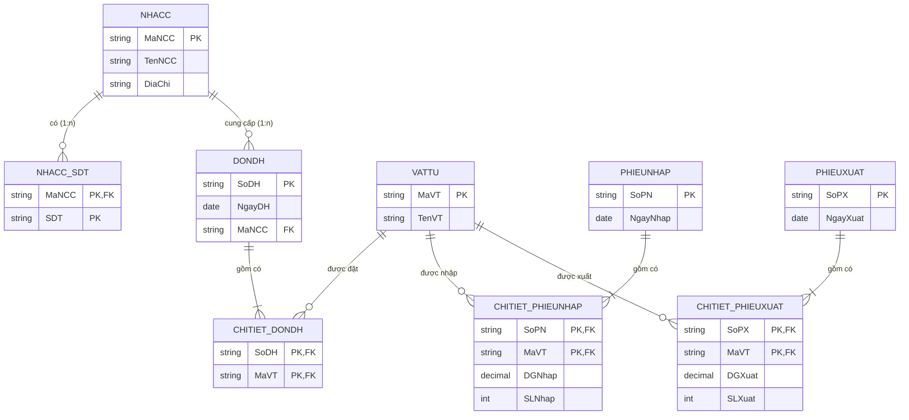

# BÁO CÁO: CHUYỂN ĐỔI MÔ HÌNH ERD SANG MÔ HÌNH DỮ LIỆU QUAN HỆ

**Bài tập:** Chuyển đổi mô hình ERD quản lý vật tư sang mô hình dữ liệu quan hệ  
**Mục tiêu:** Áp dụng các quy tắc chuẩn hóa để chuyển đổi hoàn chỉnh các thực thể, mối quan hệ và thuộc tính đa trị từ ERD sang lược đồ quan hệ trong RDBMS.

---

## 🖼️ Sơ đồ chuyển đổi trực quan

---

## 📋 BƯỚC 1: XÁC ĐỊNH CÁC THỰC THỂ CÓ TRONG MÔ HÌNH ERD

Trong mô hình ERD gốc, ta có 5 thực thể mạnh:
1. **`PHIEUXUAT` (Phiếu xuất):**
   - Thuộc tính khóa: `SoPX` (Số phiếu xuất)
   - Thuộc tính đơn: `NgayXuat` (Ngày xuất kho)
2. **`VATTU` (Vật tư):**
   - Thuộc tính khóa: `MaVT` (Mã vật tư)
   - Thuộc tính đơn: `TenVT` (Tên vật tư)
3. **`PHIEUNHAP` (Phiếu nhập):**
   - Thuộc tính khóa: `SoPN` (Số phiếu nhập)
   - Thuộc tính đơn: `NgayNhap` (Ngày nhập kho)
4. **`DONDH` (Đơn đặt hàng):**
   - Thuộc tính khóa: `SoDH` (Số đơn hàng)
   - Thuộc tính đơn: `NgayDH` (Ngày đặt hàng)
5. **`NHACC` (Nhà cung cấp):**
   - Thuộc tính khóa: `MaNCC` (Mã nhà cung cấp)
   - Thuộc tính đơn: `TenNCC` (Tên nhà cung cấp), `DiaChi` (Địa chỉ)
   - Thuộc tính đa trị: `SDT` (Số điện thoại - vẽ nét đôi)

---

## 🔗 BƯỚC 2: XÁC ĐỊNH CÁC MỐI QUAN HỆ ĐỂ SINH RA CÁC TRƯỜNG VÀ BẢNG TƯƠNG ỨNG

### 1. Mối quan hệ Một - Nhiều ($1 - n$) giữa `NHACC` và `DONDH`:
- **Bản chất:** Một nhà cung cấp có thể cung ứng cho nhiều đơn đặt hàng ($n$), mỗi đơn đặt hàng chỉ do một nhà cung cấp phụ trách ($1$).
- **Quy tắc chuyển đổi:** Lấy khóa chính ở phía $1$ (`MaNCC`) đưa sang phía $n$ (`DONDH`) làm **Khóa ngoại (FK)**.
- **Kết quả:** Bảng `DONDH` bổ sung thêm cột `MaNCC`:
  $$\text{DONDH}(\underline{\text{SoDH}}, \text{NgayDH}, \text{MaNCC})$$

### 2. Mối quan hệ Nhiều - Nhiều ($n - m$) giữa `PHIEUXUAT` và `VATTU` (Quan hệ "Xuất"):
- **Bản chất:** Một phiếu xuất có thể xuất nhiều vật tư, một vật tư có thể xuất trong nhiều phiếu. Có 2 thuộc tính riêng của quan hệ: `DGXuat` (Đơn giá xuất) và `SLXuat` (Số lượng xuất).
- **Quy tắc chuyển đổi:** Tạo **bảng trung gian mới** mang tên `CHITIET_PHIEUXUAT`. Khóa chính là sự kết hợp khóa chính của 2 thực thể tham gia (`SoPX`, `MaVT`), đồng thời chứa 2 thuộc tính riêng.
- **Kết quả:**
  $$\text{CHITIET\_PHIEUXUAT}(\underline{\text{SoPX}}, \underline{\text{MaVT}}, \text{DGXuat}, \text{SLXuat})$$

### 3. Mối quan hệ Nhiều - Nhiều ($n - m$) giữa `VATTU` và `PHIEUNHAP` (Quan hệ "Nhập"):
- **Bản chất:** Một phiếu nhập có thể nhập nhiều vật tư, một vật tư nhập trong nhiều phiếu. Thuộc tính riêng: `DGNhap` (Đơn giá nhập) và `SLNhap` (Số lượng nhập).
- **Quy tắc chuyển đổi:** Tạo **bảng trung gian mới** `CHITIET_PHIEUNHAP`. Khóa chính phức hợp là `(SoPN, MaVT)`.
- **Kết quả:**
  $$\text{CHITIET\_PHIEUNHAP}(\underline{\text{SoPN}}, \underline{\text{MaVT}}, \text{DGNhap}, \text{SLNhap})$$

### 4. Mối quan hệ Nhiều - Nhiều ($n - m$) giữa `DONDH` và `VATTU` (Quan hệ "Đặt"):
- **Bản chất:** Một đơn hàng đặt nhiều vật tư, một vật tư có thể nằm trong nhiều đơn hàng.
- **Quy tắc chuyển đổi:** Tạo **bảng trung gian mới** `CHITIET_DONDH` với khóa chính phức hợp gồm 2 khóa ngoại `(SoDH, MaVT)`.
- **Kết quả:**
  $$\text{CHITIET\_DONDH}(\underline{\text{SoDH}}, \underline{\text{MaVT}})$$

---

## 📱 BƯỚC 3: XÁC ĐỊNH THUỘC TÍNH ĐA TRỊ VÀ TẠO THÀNH BẢNG MỚI

- **Thuộc tính đa trị:** Thuộc tính `SDT` (Số điện thoại) của thực thể `NHACC` (vì một nhà cung cấp có thể có nhiều số điện thoại liên lạc).
- **Quy tắc chuẩn hóa 1NF:** Trong cơ sở dữ liệu quan hệ, mỗi ô dữ liệu phải chứa giá trị nguyên tử (Atomic value), không được chứa danh sách đa trị lặp lại.
- **Cách chuyển đổi:**
  - Tách `SDT` ra khỏi bảng `NHACC`.
  - Tạo bảng mới: `NHACC_SDT` (hoặc `SDT_NHACC`).
  - Đưa khóa chính của bảng gốc (`MaNCC`) sang làm **Khóa ngoại**.
  - Khóa chính của bảng mới là tổ hợp cả 2 cột: `(MaNCC, SDT)`.
- **Kết quả:**
  $$\text{NHACC}(\underline{\text{MaNCC}}, \text{TenNCC}, \text{DiaChi})$$
  $$\text{NHACC\_SDT}(\underline{\text{MaNCC}}, \underline{\text{SDT}})$$

---

## 📊 BƯỚC 4: LIỆT KÊ DANH SÁCH CÁC BẢNG SAU KHI CHUYỂN ĐỔI XONG

Sau khi thực hiện đầy đủ 3 bước trên, ta thu được hệ thống gồm **8 bảng quan hệ** chuẩn hóa như sau:

| STT | Tên bảng (Relation) | Danh sách thuộc tính | Khóa chính (PK) | Khóa ngoại (FK) |
|:---:|:---|:---|:---|:---|
| 1 | **`NHACC`** | `MaNCC`, `TenNCC`, `DiaChi` | `MaNCC` | *Không có* |
| 2 | **`NHACC_SDT`** | `MaNCC`, `SDT` | `(MaNCC, SDT)` | `MaNCC` $\rightarrow$ `NHACC(MaNCC)` |
| 3 | **`DONDH`** | `SoDH`, `NgayDH`, `MaNCC` | `SoDH` | `MaNCC` $\rightarrow$ `NHACC(MaNCC)` |
| 4 | **`VATTU`** | `MaVT`, `TenVT` | `MaVT` | *Không có* |
| 5 | **`CHITIET_DONDH`** | `SoDH`, `MaVT` | `(SoDH, MaVT)` | `SoDH` $\rightarrow$ `DONDH`, `MaVT` $\rightarrow$ `VATTU` |
| 6 | **`PHIEUNHAP`** | `SoPN`, `NgayNhap` | `SoPN` | *Không có* |
| 7 | **`CHITIET_PHIEUNHAP`** | `SoPN`, `MaVT`, `DGNhap`, `SLNhap` | `(SoPN, MaVT)` | `SoPN` $\rightarrow$ `PHIEUNHAP`, `MaVT` $\rightarrow$ `VATTU` |
| 8 | **`PHIEUXUAT`** | `SoPX`, `NgayXuat` | `SoPX` | *Không có* |
| 9 | **`CHITIET_PHIEUXUAT`** | `SoPX`, `MaVT`, `DGXuat`, `SLXuat` | `(SoPX, MaVT)` | `SoPX` $\rightarrow$ `PHIEUXUAT`, `MaVT` $\rightarrow$ `VATTU` |

